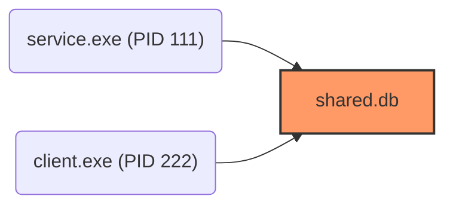

# who-locked

[](https://github.com/negg0s/who-locked/actions/workflows/ci.yml)
[](LICENSE)

A Windows command-line utility for finding which processes are holding locks on a file or folder. It can inspect open handles through the Windows Restart Manager API, inspect loaded DLL memory modules, decode access rights, close specific file handles without killing processes, take point-in-time snapshots, diff lock changes, analyze lock contention graphs, detect leaked locks during command execution, record lock timelines to JSONL, render ASCII Gantt timeline charts, benchmark query latency, scan directory trees, monitor lock transitions in real time, launch an interactive terminal UI, or terminate offending processes and clean stubborn directories.

Requirements: Windows 10 or newer, Python 3.9 or newer.

## Why this exists

When Windows displays:

```text
The action can't be completed because the file is open in another program
```

it often does not say which process is responsible. Developers encounter this when removing `node_modules`, updating DLLs, deleting virtual environments, clearing build caches, or overwriting binary outputs.

`who-locked` queries the Windows Restart Manager API (`rstrtmgr.dll`), loaded module memory maps (`psapi`), and NT system handle tables (`ntdll.dll`) to find exact processes, decode access masks, render lock timelines, and close individual file handles.

## Install

```powershell
pip install -e . --no-cache-dir
```

For development:

```powershell
pip install -e . --no-cache-dir
pip install pytest --no-cache-dir
```

## Quick start

Inspect a locked file or folder:

```powershell
who-locked inspect "C:\path\to\locked_file.txt"
```

Example output:

```text
Target: C:\src\app\build\app.exe
Type:   File
Status: LOCKED by 1 process(es)

PID      NAME                     TYPE           MEMORY       USER
---------------------------------------------------------------------------
14820    app.exe                  Console        48.2 MB      DESKTOP\user
```

Add `--verbose` to view full executable paths, parent processes, command-line arguments, and decoded handle access rights (e.g. `READ | WRITE | DELETE`):

```powershell
who-locked inspect "C:\path\to\locked_file.txt" --verbose
```

Output formats for scripts, pipelines, markdown reports, and web inspection:

```powershell
# GitHub-flavored Markdown table:
who-locked inspect "C:\path\to\locked_file.txt" --format markdown

# Standalone dark-mode HTML report:
who-locked inspect "C:\path\to\locked_file.txt" --format html > report.html

# JSON format:
who-locked inspect "C:\path\to\locked_file.txt" --format json

# Space-separated PIDs only (pipe-friendly):
who-locked inspect "C:\path\to\locked_file.txt" --format pids

# CSV format:
who-locked inspect "C:\path\to\locked_file.txt" --format csv

# Quiet mode (exit code only: 0=free, 1=locked, 2=error):
who-locked inspect "C:\path\to\locked_file.txt" -q
```

Example pipe into PowerShell process termination:

```powershell
who-locked inspect "C:\path\to\locked_file.txt" --format pids | Stop-Process -Force
```

## Finding processes holding loaded DLLs

When updating or overwriting a `.dll`, `.pyd`, or `.node` binary, the file is often locked because a running process has mapped it into memory:

```powershell
who-locked dll "C:\games\app\plugin.dll"
```

Example output:

```text
Loaded Module Inspection: C:\games\app\plugin.dll
Module is loaded in 1 running process(es):

PID      NAME                     MEMORY       USER
-----------------------------------------------------------------
14820    app.exe                  124.5 MB     DESKTOP\user
         Path: C:\games\app\app.exe
```

## Closing handles without terminating processes

To release a file without killing the application holding it (such as Visual Studio or an editor), close only the matching file handle:

```powershell
who-locked close-handle "C:\path\to\locked_file.txt"
```

This queries the system handle table, duplicates the file handle with `DUPLICATE_CLOSE_SOURCE`, and closes it at the OS level while keeping the application running.

Skip confirmation prompt:

```powershell
who-locked close-handle "C:\path\to\locked_file.txt" --yes
```

## Recording lock timelines (tracing)

Record lock acquisition and release events over time to a structured JSONL file during builds, tests, or compiler runs:

```powershell
who-locked trace "C:\src\app\build\output.bin" --duration 15.0 --output build_locks.jsonl
```

Analyze hold duration statistics:

```powershell
who-locked stats build_locks.jsonl
```

Render an ASCII Gantt timeline chart directly in your terminal:

```powershell
who-locked plot build_locks.jsonl
```

Example output:

```text
Lock Timeline: build_locks.jsonl (Window: 14.80s, 3 cycles)
Time: 0.0s                                            14.80s
      |--------------------------------------------------|
PID 4410 (node.exe)
      |[==========]                                      |  3120.0ms
PID 8412 (cl.exe)
      |            [==============]                      |  4200.0ms
PID 9120 (link.exe)
      |                             [===================]|  5800.0ms
```

## Interactive terminal UI (TUI)

Launch a console dashboard to navigate active locks and manage processes with single keystrokes:

```powershell
who-locked tui "C:\projects\my-app\node_modules"
```

Controls:
- `Up` / `Down`: Navigate process list
- `c`: Close file handle only (keeps process running)
- `x`: Terminate selected process
- `r`: Refresh lock inspection
- `q` / `Esc`: Exit dashboard

## Benchmarking lock query latency

Measure the latency and throughput of Windows lock inspection APIs on your machine:

```powershell
who-locked bench --samples 50
```

Example output:

```text
Running benchmark (50 samples)...

Benchmark Results:
Operation                  Min (ms)   Median (ms)    p95 (ms)   Max (ms)
------------------------------------------------------------------------
Restart Manager Query      0.342      0.485          0.720      1.180
NT Handle Table Scan       3.812      4.120          4.950      6.240
------------------------------------------------------------------------
System handles scanned: 168,420 (~40,878 handles/sec)
```

## Finding files by process name or PID

When a known process (such as `node.exe` or `java.exe`) is hanging, find every file it holds across a directory tree:

```powershell
who-locked find "C:\projects\my-app" --process node.exe
# or filter by PID:
who-locked find "C:\projects\my-app" --pid 9120
```

## Scanning directory trees

When deleting large directories (such as `node_modules` or `.venv`), nested files can block the folder from being removed. Use `tree` to locate each locked file:

```powershell
who-locked tree "C:\projects\my-app\node_modules"
```

Example output:

```text
Root:    C:\projects\my-app\node_modules
Scanned: 1240 file(s)

Found 2 locked item(s):

  * @esbuild\win32-x64\esbuild.exe
      -> PID 9120 (esbuild.exe, Console, 14.2 MB, parent: node.exe)
  * .cache\build.lock
      -> PID 4410 (node.exe, Console, 88.5 MB, parent: cmd.exe)

Summary by locking process:
  - PID 4410 (node.exe): 1 file(s)
  - PID 9120 (esbuild.exe): 1 file(s)
```

## Cleaning stubborn directories

When `rmdir /s /q` or `Remove-Item -Recurse -Force` fails because a background process holds a handle, use `clean`:

```powershell
who-locked clean "C:\projects\my-app\node_modules"
```

This scans the folder tree for locks, prompts to terminate locking processes, waits for handles to close, and deletes the directory.

Use `--dry-run` to preview without making any changes:

```powershell
who-locked clean "C:\projects\my-app\node_modules" --dry-run
```

Use `-y` or `--yes` to proceed without prompts:

```powershell
who-locked clean "C:\projects\my-app\node_modules" --yes
```

## Real-time lock monitoring

Watch a file or folder and track when locks are acquired and released:

```powershell
who-locked watch "C:\path\to\output.bin"
```

Example output:

```text
Watching C:\path\to\output.bin for lock changes (interval: 0.5s, press Ctrl+C to stop)...
[17:15:02.124] [LOCKED] Locked by: cl.exe (PID 8412)
[17:15:05.450] [FREE]   Target is free after 3.326s
```

Automation flags:
- `--exit-on-free`: Exit immediately when the target becomes free.
- `--exit-on-lock`: Exit immediately when a lock is detected.
- `--beep`: Sound console bell on state change.

## Releasing locks

Terminate processes holding a file:

```powershell
who-locked release "C:\path\to\locked_file.txt"
```

When multiple processes hold handles, use interactive mode to select which PIDs to terminate:

```powershell
who-locked release "C:\path\to\locked_file.txt" -i
```

Skip confirmation:

```powershell
who-locked release "C:\path\to\locked_file.txt" --yes
```

If a process ignores graceful termination, pass `-f` or `--force`:

```powershell
who-locked release "C:\path\to\locked_file.txt" --force --yes
```

## Lock snapshots and differential analysis

Save a point-in-time record of all active locks across a project or directory tree:

```powershell
who-locked snapshot "C:\src\project" -o snapshot-before.json
```

Compare two snapshots, or compare a saved snapshot against the current disk state to see which files were newly locked or released:

```powershell
# Compare two snapshot files:
who-locked diff snapshot-before.json snapshot-after.json

# Compare a saved snapshot against live disk state:
who-locked diff snapshot-before.json "C:\src\project"

# Output diff as JSON or Markdown:
who-locked diff snapshot-before.json "C:\src\project" --format markdown
who-locked diff snapshot-before.json "C:\src\project" --format json
```

Example text output:

```text
Lock Diff Summary:
  Before: 2026-11-02T10:00:00Z
  After:  2026-11-02T10:05:00Z
  Changes detected: Yes
  Added: 1 | Released: 1 | Persisting: 1
-----------------------------------------------------------------
[+] Added Locks (1):
    * C:\src\project\target\out.lock -> rustc.exe (PID 9120)
[-] Released Locks (1):
    * C:\src\project\.cargo\.package-cache (was: cargo.exe (PID 4410))
[=] Persisting Locks (1):
    * C:\src\project\app.db -> python.exe (PID 1024)
```

## Detecting leaked locks during command execution

Run build tools, test suites, or background tasks and automatically detect any files left locked when the command finishes:

```powershell
who-locked run --dir "C:\src\project" -- pytest tests/
who-locked run --dir "C:\src\project" --fail-on-leak -- cargo test
```

If any processes leave handles open in the target folder, `who-locked run` reports the exact files and offending PIDs.

## Lock contention graph and Mermaid diagrams

Analyze shared lock contentions when multiple processes access overlapping files:

```powershell
# Text view:
who-locked graph "C:\src\project"

# GitHub-compatible Mermaid flowchart:
who-locked graph "C:\src\project" --format mermaid
```

Example Mermaid output:



## Safety guardrails

`who-locked` includes built-in protections against accidental system instability:
- Refuses to terminate protected system kernel processes (PID 0, PID 4).
- Refuses to terminate critical Windows processes (`smss.exe`, `csrss.exe`, `wininit.exe`, `winlogon.exe`, `services.exe`, `lsass.exe`).
- Refuses to terminate its own process.

## Waiting for locks to clear

In build scripts or CI pipelines, wait until a process finishes writing and releases its handle:

```powershell
who-locked wait "C:\path\to\output.bin" --timeout 15.0
```

Returns exit code 0 when the file is free, or exit code 1 if the timeout expires.

## Shell completion

Generate tab-completion script for PowerShell:

```powershell
who-locked completion powershell | Out-String | Invoke-Expression
```

Add that command to `$PROFILE` for permanent tab-completion.
For Bash:

```bash
eval "$(who-locked completion bash)"
```

## Explorer context menu integration

Add a "Who is locking this?" item to the Windows Explorer right-click context menu:

```powershell
who-locked menu install
```

This writes to `HKEY_CURRENT_USER\Software\Classes` and does not require administrator rights.

To remove it:

```powershell
who-locked menu uninstall
```

Check status:

```powershell
who-locked menu status
```

## Diagnostics

Verify Windows Restart Manager availability and permissions:

```powershell
who-locked doctor
```

Example output:

```text
Environment Diagnostics:
  [OK]   Operating System             Windows 11 (Build 10.0.26200)
  [OK]   Restart Manager API          rstrtmgr.dll loaded
  [OK]   Administrator Privileges     Standard User
  [OK]   Explorer Context Menu        Not installed (use 'who-locked menu install')

System is ready for lock inspection.
```

## Development

Run tests and check text compliance:

```powershell
pytest
python tools/check_text.py
```

## License

MIT. See [LICENSE](LICENSE).
